

  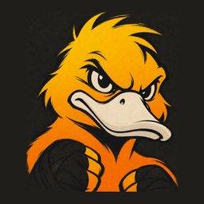

<h1 align="center">Duckin</h1>

<b>Stop ducking your workouts.</b> 
A voice coach for the heavy bag that calls your combos, rounds and form cues in real time.

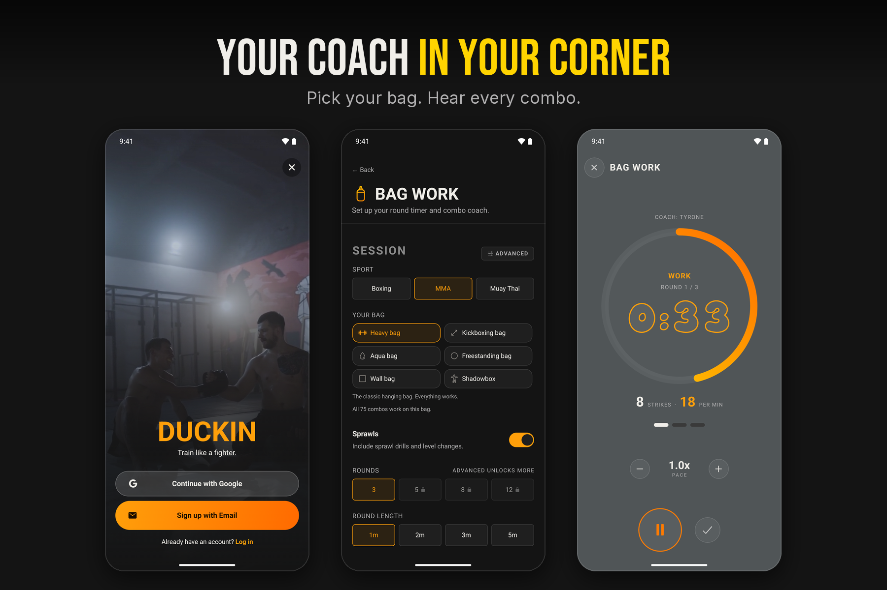

> This is a showcase of the app. The source code is private.

## What it does

- 🥊 **Voice coach for the heavy bag:** four coaches call your combos, form cues and rounds in real time
- 🎯 **Built around you:** pick your sport, bag, level, pace and the fighter style you want to train like
- 🎧 **Music ducks** under the coach instead of stopping
- ⏱️ **More training modes:** sparring rounds, conditioning intervals, guided stretching and interval timers
- 🎙️ **Voice notes:** record what happened in sparring and play it back with the silences skipped
- 📈 **Progress:** training log, streaks, XP, badges and personal records
- 🏆 **Arena:** weekly leagues, leaderboards and a community message board
- ⭐ **Duckin Advanced:** workout builder, combo builder, metrics, monthly report and every coach

## How it's built

- 🤖 **Claude Code** as a pair programmer: I made the product and design calls and tested every build on the bag, and Claude wrote and tested code with me
- 📱 **Expo and React Native** with TypeScript, one codebase for iPhone and Android
- 🗣️ **ElevenLabs** coach voices, cut into hundreds of short clips the app stitches together live
- 💳 **RevenueCat** for subscriptions and one-off coach purchases, with store prices, a store-compliant paywall and Customer Center
- 🔒 **Supabase** for accounts, cloud backup and the Arena, with row level security on every table
- ✅ **750 automated tests**

  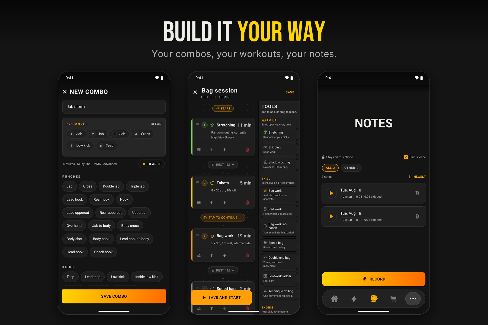
  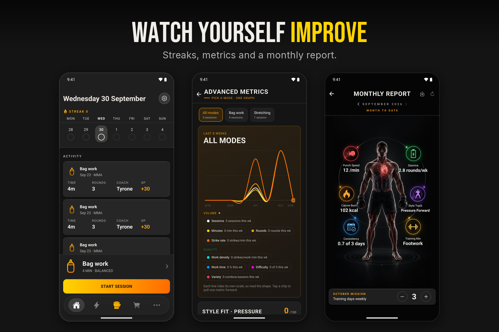

## Screenshots

<table>
<tr>
<td align="center">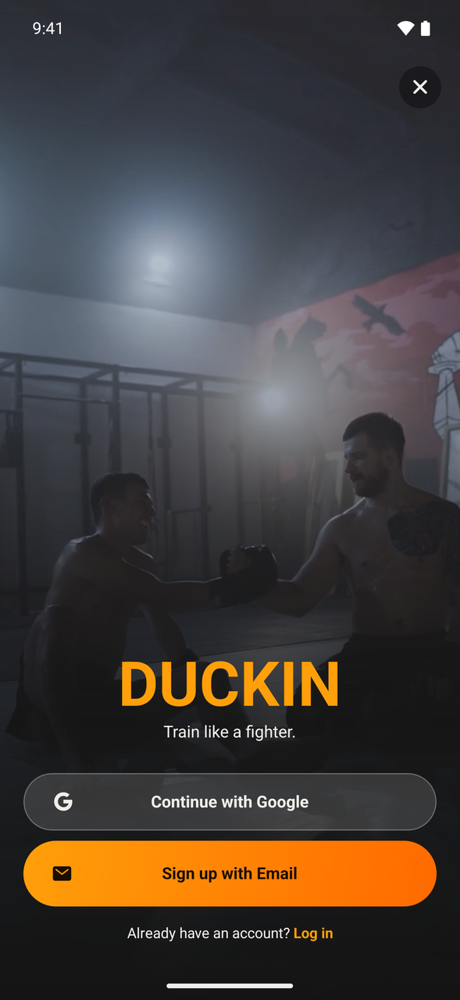 Sign up</td>
<td align="center">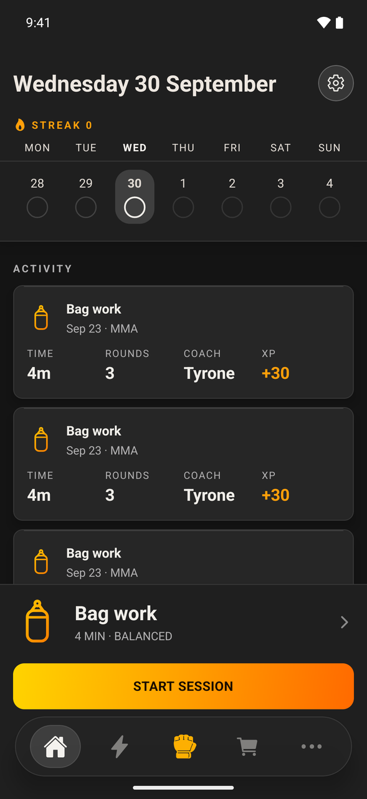 Home</td>
<td align="center">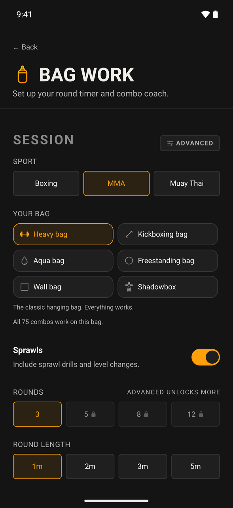 Bag work setup</td>
<td align="center">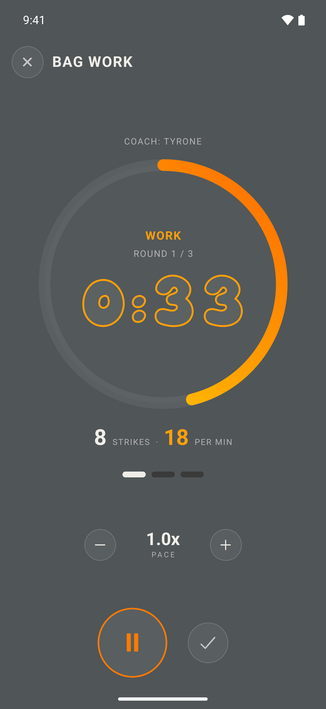 Live round</td>
</tr>
<tr>
<td align="center">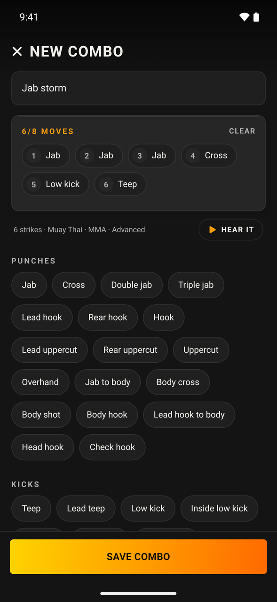 Combo builder</td>
<td align="center">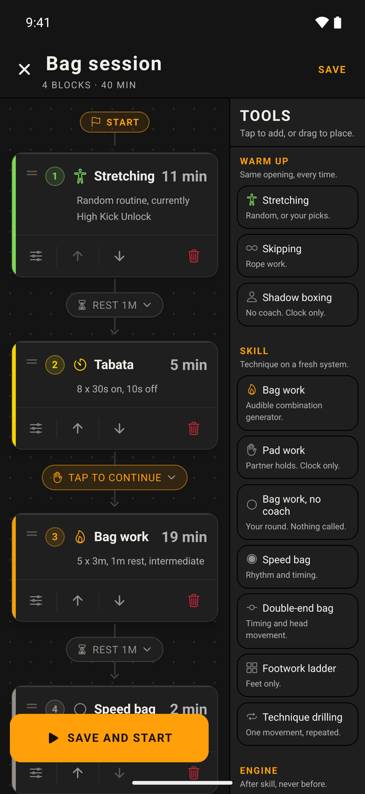 Workout builder</td>
<td align="center">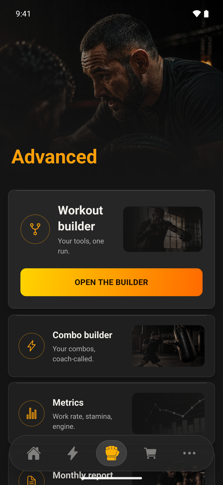 Advanced</td>
<td align="center">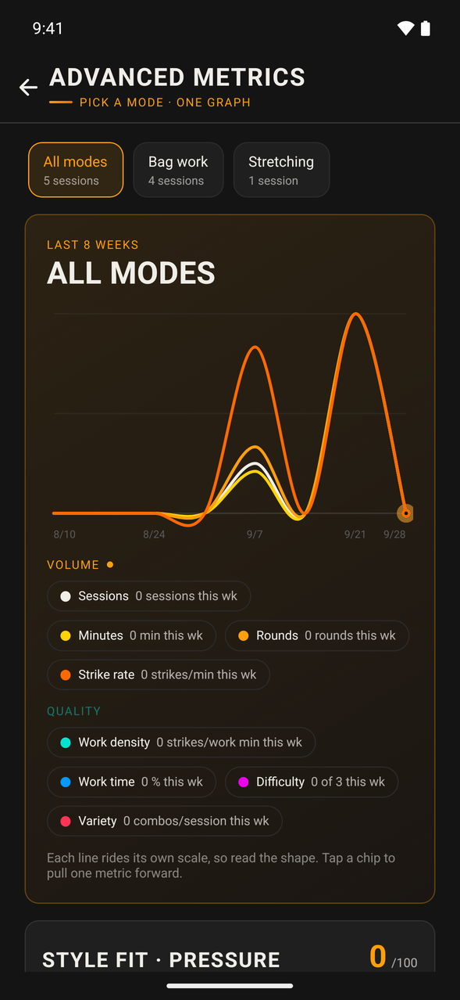 Metrics</td>
</tr>
<tr>
<td align="center">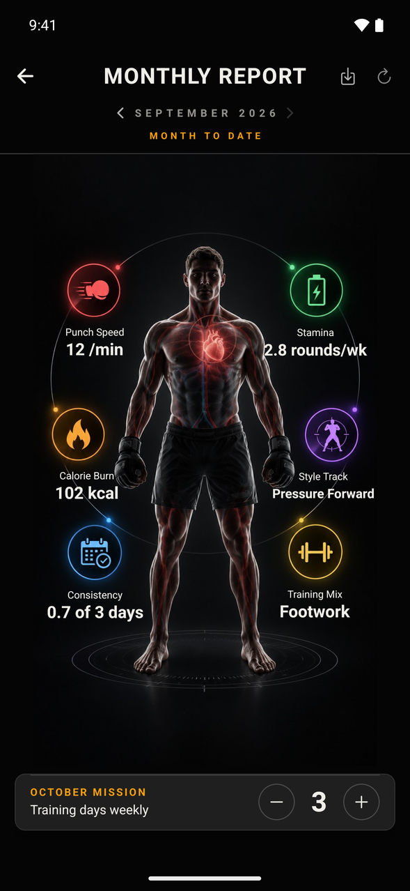 Monthly report</td>
<td align="center">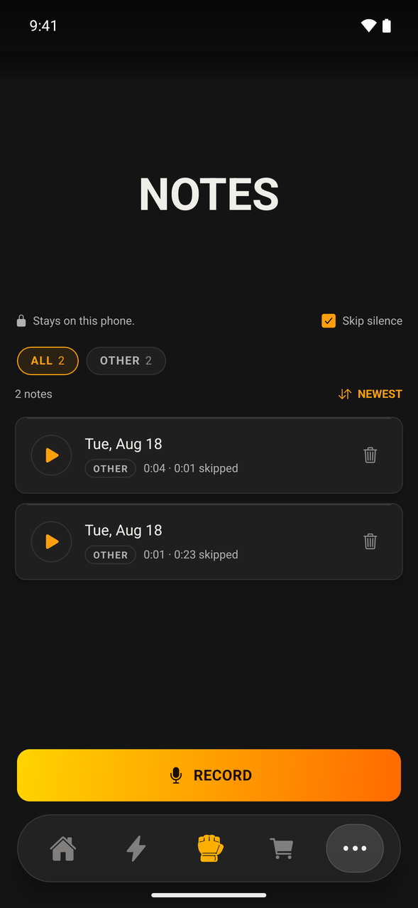 Voice notes</td>
<td align="center">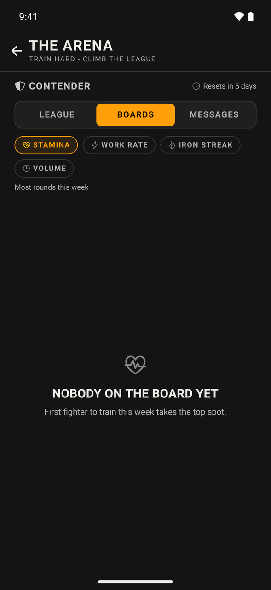 Arena</td>
<td align="center">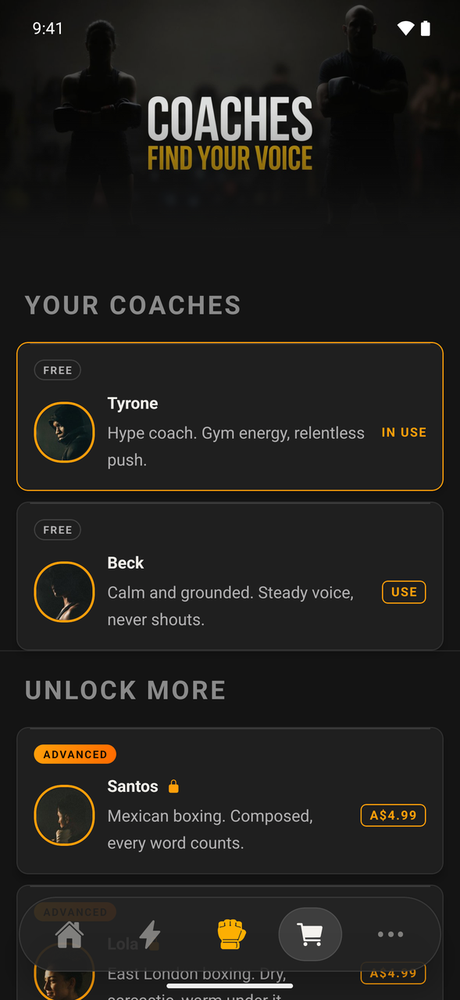 Coaches</td>
</tr>
<tr>
<td align="center">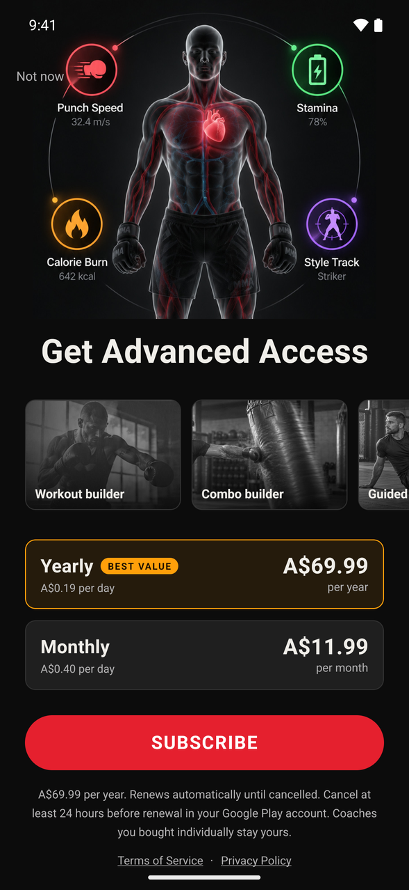 Paywall</td>
</tr>
</table>

---

© 2026 Harry Howarth. All rights reserved. The Duckin name, logo, coach voices and images may not be used without permission.
